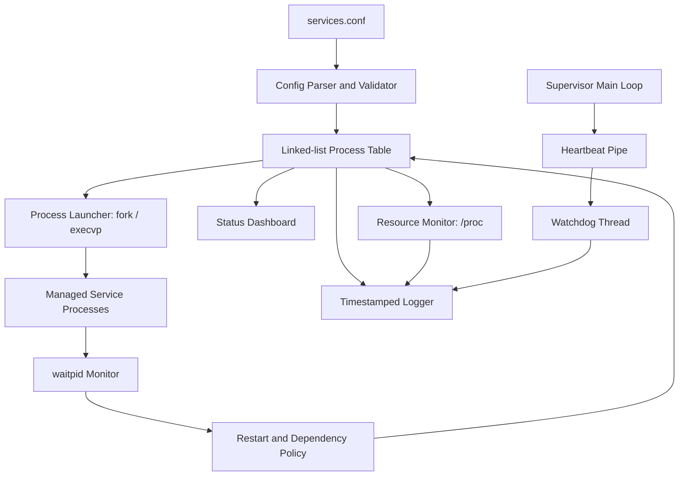
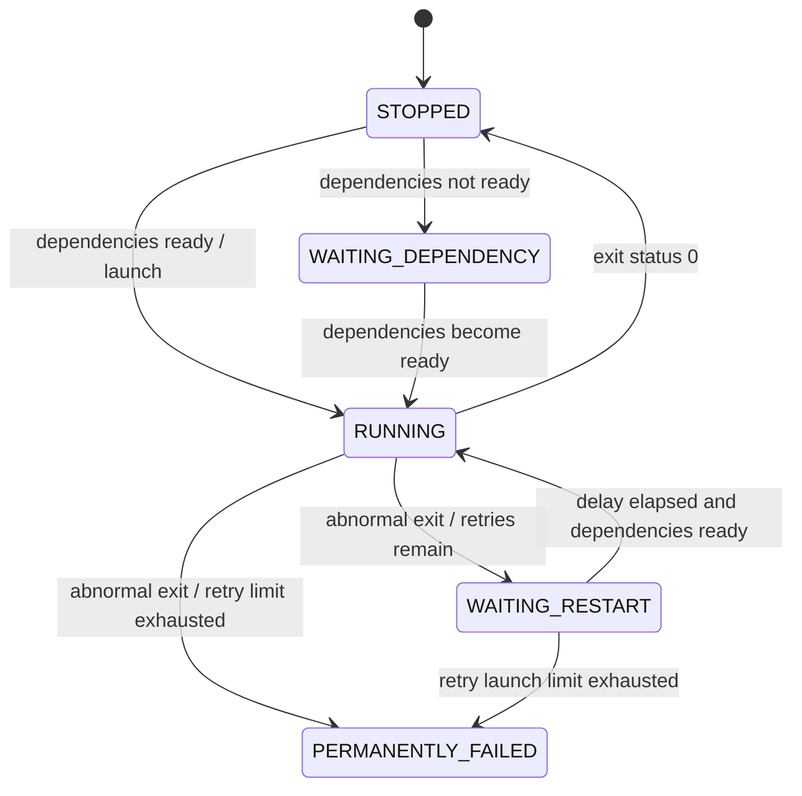

# High-Level and Low-Level Design

## High-level design

The supervisor loads a service configuration, validates names and dependency graph, launches services in dependency order, monitors child state, applies bounded restart policy, and performs graceful shutdown. A separate resource-monitor thread reads `/proc`; a watchdog thread monitors the main-loop heartbeat received over a pipe.

## Low-level modules

| Module | Responsibility |
|---|---|
| `main.c` | CLI, signal handlers, optional daemonization, thread lifecycle and heartbeat pipe setup |
| `config.c` | Parse pipe-delimited records, tokenize quoted command arguments, parse dependencies, reject invalid graphs |
| `supervisor.c` | Process table, launch, dependency readiness, `waitpid`, restart scheduling, status and shutdown |
| `procmon.c` | Periodic `/proc/<pid>/status` VmRSS collection |
| `logger.c` | Timestamped serialized file logging |
| `tests/test_config.cpp` | GoogleTest configuration unit tests |
| `tests/integration_dependencies.sh` | Dependency ordering integration test |
| `tests/integration_restart.sh` | Restart-limit and clean-exit integration test |

## Core data structures

`process_t` stores service name, command, argv, dependency names, restart configuration, PID, state, exit status, next restart time and linked-list pointer. `supervisor_t` owns the list, mutex, shutdown flag, heartbeat write descriptor and log path.

## State model

## Synchronization and process safety

The process list and mutable process state are accessed under the supervisor mutex. The logger uses its own mutex. Heartbeat delivery uses a POSIX pipe; the watchdog polls the read end with a timeout. Child processes are launched with `execvp`, and the parent reaps them with `waitpid`. Shutdown sends SIGTERM, waits for a bounded interval, then sends SIGKILL to remaining direct child PIDs.
